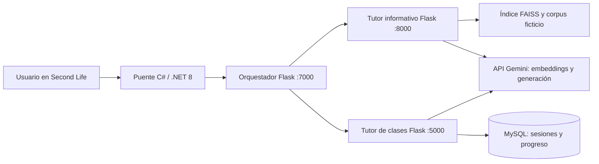

# Arquitectura

Las interfaces HTML incluidas permiten probar ambos tutores sin entrar en Second Life.
El orquestador decide el destino por el modo solicitado; no es un planificador autónomo con LLM.

## Flujo informativo

Ingesta de YAML/CSV/Markdown → fragmentos → embeddings → índice FAISS.
Pregunta → embedding de consulta → búsqueda vectorial → contexto → respuesta de Gemini.
El índice y sus metadatos se regeneran localmente; no se distribuyen índices históricos.
El código no garantiza citas verificables ni exactitud factual por sí mismo.

## Flujo de clases

El tutor recoge tema, nivel y objetivo, propone un plan y espera confirmación.
La conversación y el estado se persisten en MySQL.
El puente adapta y envía los mensajes al mundo virtual.

## Límites actuales

Prototipo de tutoría con IA para ejecución local. Las rutas no incorporan autenticación de usuarios.
Los historiales pueden contener datos personales; usar identidades ficticias.
Los límites y circuit breakers viven en memoria de cada proceso.
No se certifica concurrencia distribuida ni disponibilidad en producción.
